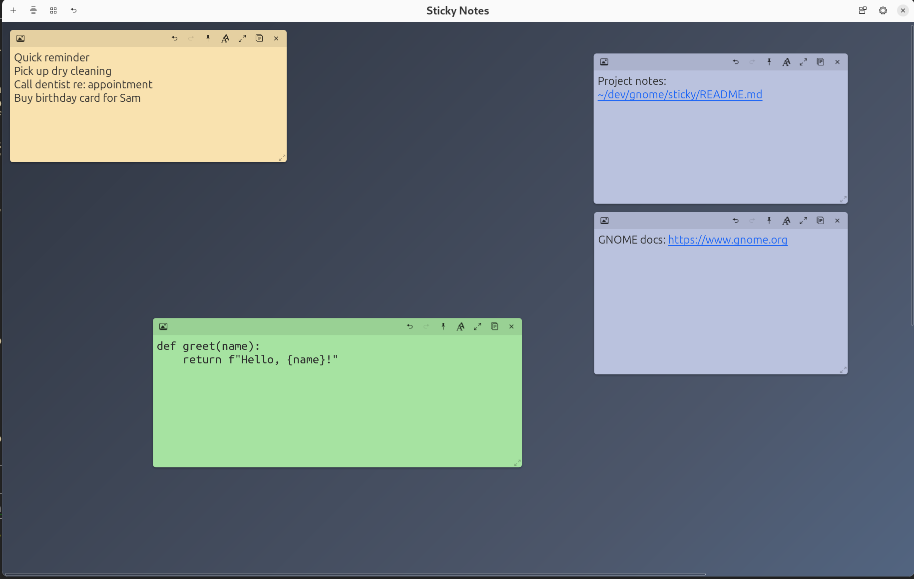
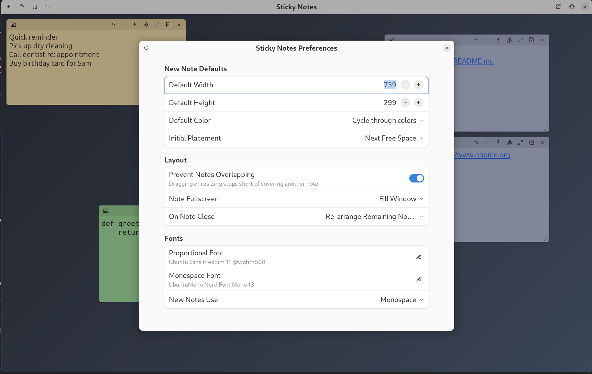
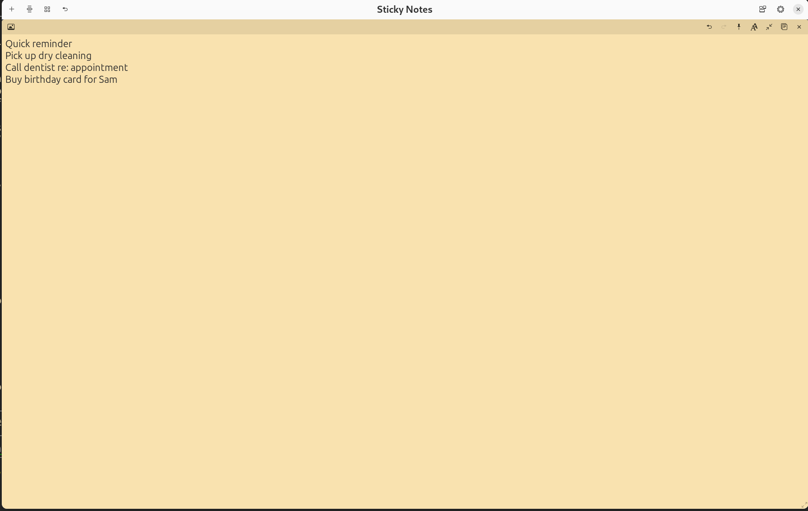
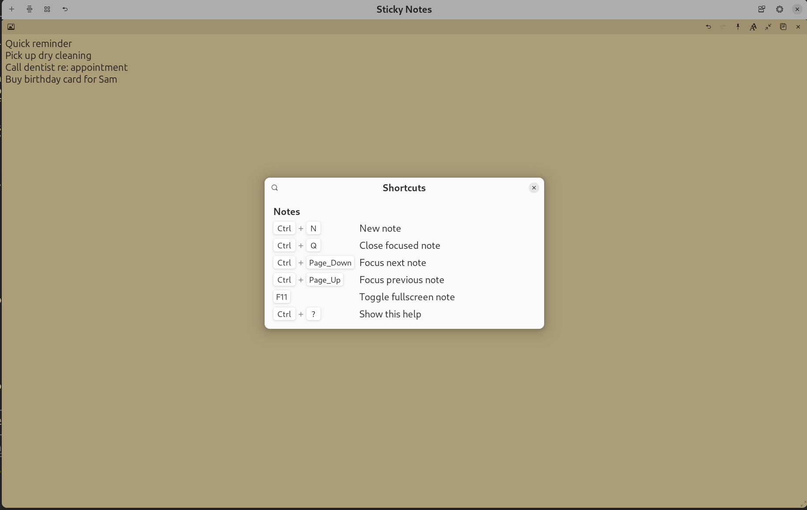

# Sticky Notes

A digital post-it notes app for GNOME. Notes live as draggable, resizable
cards on a single scrollable board window, so the whole app behaves like
one normal application in the window switcher — no per-note windows, no
Wayland window-positioning headaches.



## The board is bigger than the window

The notes don't live in screen coordinates — they live at a fixed position
on an internal canvas that only the app manages. The window is just a
viewport onto that canvas, with scrollbars appearing whenever the canvas
is bigger than the window.

This means you can deliberately use the app like a pinboard bigger than
your screen: enlarge the window (or go fullscreen), spread notes out
further than would fit on a normal window, then shrink the window back
down and scroll around to find them — their positions never change just
because the window resized. The canvas itself auto-sizes to exactly fit
however far out your furthest note is (plus a small margin), so the
window can always be shrunk right down to that size with no scrollbar,
and only shows one once you go smaller than that.

This is also what solves the "remember note positions across screens"
requirement that kicked this project off — since positions are relative
to the app's own canvas rather than to screen/monitor resolution, a note
stays exactly where you left it whether you're on a laptop screen, an
external monitor, or you've resized the window entirely.

## Features

- **Draggable, resizable notes** on a gradient board, with click-to-raise
  z-ordering and an optional "prevent overlap" mode (drag freely, then
  snap into a free grid cell on release).
- **Undo/redo** per note, plus a "Recently Closed" list (60-day retention)
  to bring back a deleted note — restoring dodges any overlap automatically.
- **Clickable links**: URLs and existing file paths typed into a note
  become clickable (a file path is only linkified if it actually exists).
- **Paste images** (Ctrl+V) directly into a note. Click an image for a menu
  to view it full screen, copy, save, resize before copying/saving, open it
  in GIMP (if installed), or delete it.
- **Per-note controls**: color, proportional/monospace font toggle, copy
  text to clipboard, fullscreen (fill the window or the whole screen).
- **Arrange tools**: tidy all notes into a cascade or a grid with one
  click, or set a preference to auto re-arrange into a grid whenever a
  note is closed.
- **Preferences**: default note size/color (including "cycle through
  colors" for new notes), initial placement (cascade or next free
  space), overlap prevention, note fullscreen behavior, on-close
  behavior, and separate proportional/monospace fonts.
- **Configurable note colors**: the Colors page in Preferences lets you
  add, remove, rename, reorder and recolor the note palette (as many
  colors as you like). Text switches between dark and light automatically
  for contrast, and link color is picked per note so links stay readable
  on dark or saturated backgrounds. Load one of the built-in color schemes (Pastel, Classic
  Sticky, Soft Rainbow, Nord, Solarized, Gruvbox, Dracula, Tokyo Night,
  Earth Tones, Ocean, Autumn, Neon, Monochrome) to replace the palette in
  place, so existing notes follow their slot into the new scheme, or append
  it to your current colors.
- **Board background**: each scheme comes with a matching board background
  that is applied when you replace with it. You can also set it yourself
  on the Colors page, as a solid color or a three-color diagonal gradient.
- **Christmas mode** (Preferences → Festive): snow drifting down the board
  behind your notes, a candy-cane striped band and candy cane on each note,
  a sprig of holly, and note titles (first line) in bold red. Each can be
  switched on or off. Snow is kept light on CPU: ~24 fps while the window
  is focused, ~8 fps when it isn't, paused while minimised, and still if
  animations are disabled system-wide. Pair it with the Christmas color
  scheme.
- **Custom schemes**: add your own as JSON files in
  `~/.config/sticky-notes/schemes/` (`background` is optional, 1–3 colors):

  ```json
  {
    "name": "My Scheme",
    "colors": [{"name": "Sun", "color": "#ffe08a"}, {"name": "Sea", "color": "#8ad4ff"}],
    "background": ["#1b2a3a", "#2c4a63"]
  }
  ```
- **Persistence**: notes (text, color, font, position, size) and
  preferences are saved automatically and restored on next launch.
- **Keyboard shortcuts** — see below, or open them in-app via the
  keyboard icon in the header bar (or `Ctrl+?`).



A note fullscreened to fill the whole screen (`F11`):



## Keyboard shortcuts

| Shortcut | Action |
|---|---|
| `Ctrl+N` | New note |
| `Ctrl+Q` | Close the currently focused note |
| `Ctrl+Page Down` / `Ctrl+Page Up` | Move focus to the next / previous note |
| `F11` | Toggle fullscreen for the focused note |
| `Ctrl+?` | Show keyboard shortcuts |



## Requirements

- GNOME / GTK 4 (tested on GTK 4.14, libadwaita 1.5, GNOME Shell 46)
- Python 3 with PyGObject (`python3-gi`, `gir1.2-gtk-4.0`, `gir1.2-adw-1`)

On Ubuntu:

```sh
sudo apt install python3-gi gir1.2-gtk-4.0 gir1.2-adw-1
```

## Running

```sh
./bin/sticky-notes
```

## Installing (so it shows up in the app grid / Alt-Tab)

```sh
mkdir -p ~/.local/share/applications ~/.local/share/icons/hicolor/scalable/apps
cp data/net.rfletcher.StickyNotes.desktop ~/.local/share/applications/
cp data/icons/net.rfletcher.StickyNotes.svg ~/.local/share/icons/hicolor/scalable/apps/
update-desktop-database ~/.local/share/applications/
```

The desktop file's `Exec` line points at this checkout's `bin/sticky-notes`
by absolute path — edit it if you move the checkout.

## Data locations

- Notes and closed-notes history: `~/.local/share/sticky-notes/notes.json`
- Preferences: `~/.config/sticky-notes/prefs.json`

## Project layout

```
bin/sticky-notes          launcher script
data/                     .desktop file and app icon
sticky_notes/
  main.py                 GApplication, CSS, keyboard shortcut accels
  board.py                the single board window: layout, drag/resize,
                           persistence, arrange/fullscreen/shortcuts logic
  note.py                 a single note card: text, undo/redo, links,
                           image paste, font/color/fullscreen controls
  image_tools.py          image resize dialog, save-to-file, open in GIMP
  prefs.py                Preferences model + JSON load/save
  prefs_ui.py              preferences window UI
```
